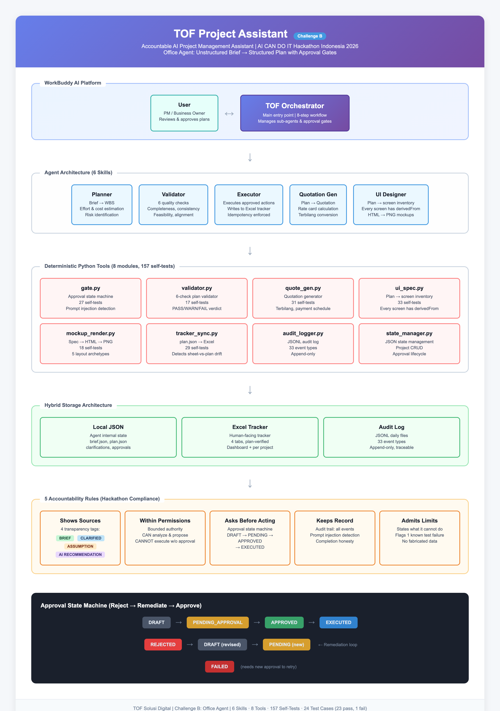

# TOF Project Assistant

**Accountable AI project manager for small software consultancies.**

Turns an unstructured client brief into a validated project plan, quotation, and UI
screen inventory — and **stops for human approval** before anything is written to a
shared file or sent to a client.

> Submission for **AI CAN DO IT — Tencent Cloud Hackathon Indonesia 2026**
> Challenge B: Office Agent (unstructured input → structured output)
> Built on WorkBuddy AI · by TOF Solusi Digital

---

## The problem it solves

A small consultancy receives a brief like this, forwarded from WhatsApp:

> *"sistemnya harus tetap bisa dipakai walaupun internet mati"* … and two paragraphs later …
> *"tolong simpan di Google Sheets online itu ya mas"*

Two incompatible requirements, five missing facts, and a budget the first estimate
will exceed. A general-purpose LLM will happily produce a confident plan anyway —
inventing the client's user count, guessing the deadline, and pricing work nobody
agreed to.

This agent does the opposite. It surfaces the contradiction, asks, waits, and shows
the source of every line it writes.

---

## What makes it *accountable* rather than just capable

| Rule | How it is enforced | Where |
|---|---|---|
| **Shows its sources** | Every plan item carries `BRIEF` / `CLARIFIED` / `ASSUMPTION` / `AI_RECOMMENDATION` | plan.json, Excel Notes column |
| **Stays within permissions** | CAN / CANNOT table; the agent cannot send email or delete data | `agent/rules/accountability.md` |
| **Asks before acting** | 6-state approval machine; only `APPROVED` may execute | `agent/tools/gate.py` |
| **Admits its limits** | 1 test fails on purpose and is published, not hidden | TC-002 |
| **Keeps a record** | 33 event types, append-only JSONL audit log | `agent/tools/audit_logger.py` |

The point is not that the agent never errs. The point is that **every claim it makes
can be checked against a file on disk** — which is why `demo/check_state.py` exists.

---

## Quick start

```bash
# 1. Deterministic tool self-tests — 8 modules, 157 assertions
python3 agent/tools/selftest.py

# 2. Challenge test cases — 24 tests (23 pass, 1 intentional failure)
python3 tests/test_cases.py

# 3. End-to-end demo, 11 scenes, no typing required
python3 demo/run_demo.py --fast

# 4. Inspect what the agent actually wrote
python3 demo/check_state.py
```

Only `openpyxl` is required beyond the standard library. No API keys, no cloud account.

---

## A 90-second walkthrough

The agent is driven by conversation, not buttons. Full copy-paste scripts live in
[`docs/CASE-STUDY-02-CHAT.md`](docs/CASE-STUDY-02-CHAT.md) (Katering Bu Sari) and
[`docs/STUDI-KASUS.md`](docs/STUDI-KASUS.md) (SG Garage).

| Turn | You type | The agent must |
|---|---|---|
| 1 | A WhatsApp-style brief | Find the gaps and **ask** — not plan |
| 2 | Answers to 4 questions | Produce a tagged plan + **approval card**, then stop |
| 3 | "Tolak, over budget" | Record the rejection, revise, issue a **new** card |
| 4 | "Setuju" | Execute, write the Excel tracker, verify |
| 5 | "Buatkan quotation" | Draft + a **second, separate** card to send it |
| 6 | "Buatkan desain UI" | Derive screens **from plan scope**, never invent them |

The three moments judges look for are all present: the agent asks, the agent waits,
and the agent refuses.

---

## Architecture



Six skills orchestrate eight deterministic Python tools. Safety-critical decisions —
approval gating, prompt-injection detection, plan validation, quotation arithmetic,
screen derivation, Excel writing — are **testable code**, not prompt text.

```
agent/
├── orchestrator/      # 8-step workflow, 5 delegation targets
├── planner/           # brief → WBS, effort, cost, risks
├── validator/         # 6 quality checks
├── executor/          # runs approved actions only
├── quotation/         # plan → quotation + terbilang
├── ui-designer/       # plan → screen inventory → mockups
├── rules/             # accountability + approval policy
└── tools/             # 8 Python modules, 157 assertions
```

---

## Repository map

| Path | What it is |
|---|---|
| `agent/` | Skills and deterministic tools — the product |
| `data/` | Mock briefs, rate card, sample plans, Excel tracker |
| `submission/` | Hackathon deliverables (description, accountability sheet, test cases, diagram) |
| `docs/` | Copy-paste test scripts and the compliance map |
| `demo/` | 11-scene demo runner + state inspector |
| `tests/` | 24 challenge test cases |
| `evidence/` | Rendered test output and screenshots |

---

## Honest limitations

Published rather than buried, because the whole premise is verifiable claims:

1. **TC-002 fails by design.** Keyword matching cannot detect every missing-information
   pattern. The orchestrator catches them semantically; the deterministic tool cannot.
2. **The screen library covers two domains** (automotive workshop, catering). A third
   domain needs new rules — it does not generalise for free.
3. **No real email is sent.** The executor blocks at `PENDING_APPROVAL` by design;
   delivery is out of scope.
4. **The Figcraft live path is designed but untested** against a running app; the
   mockup renderer is the exercised fallback, and the downgrade is reported, not hidden.

---

## Documentation

- [Project description](submission/project-description.md) — full narrative
- [Accountability sheet](submission/accountability-sheet.md) — one page, the five rules
- [Test cases](submission/test-cases.md) — all 24, including the failure
- [Case study with copy-paste chat](docs/CASE-STUDY-02-CHAT.md) — start here to try it
- [Demo script](submission/demo-script.md) — recording beats and timings
